# API Almoxarifado - Controle de Peças de Reposição

## 📌 Sobre o projeto

Este projeto é uma API REST feita em PHP e PDO para controlar peças de reposição de um almoxarifado.

A API permite cadastrar, listar, atualizar e excluir peças. As respostas são enviadas no formato JSON.

O trabalho foi desenvolvido como atividade prática da disciplina de APIs e Consultas SQL.

## ✅ O que a API permite fazer
- Cadastrar, listar, atualizar e excluir peças
- Validar os dados informados
- Enviar respostas em JSON
- Acessar o banco de dados usando PDO
- Fazer consultas SQL com as funções SUM, MAX, MIN e AVG

## 🛠 Tecnologias
- PHP
- PDO
- PostgreSQL
- JSON

## 📂 Banco de dados

O banco `almoxarifado` guarda os dados das peças usadas pela API. A imagem mostra sua criação:

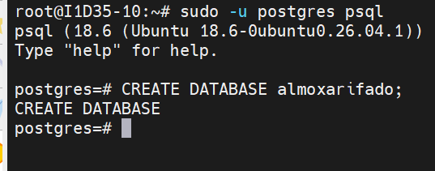

Depois de criado, o banco aparece na lista do PostgreSQL:

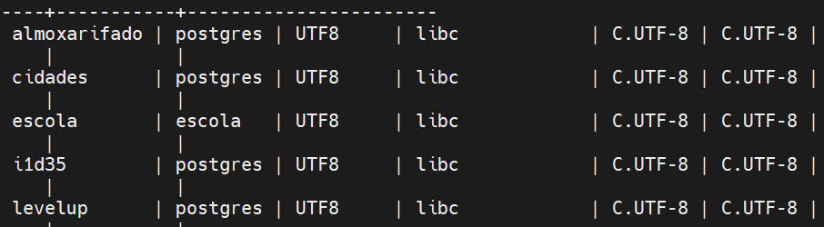

A API se conecta ao banco por meio do PDO para executar comandos SQL:

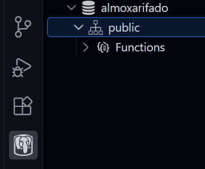

O banco se chama **almoxarifado** e a tabela usada pela API é **pecas**.

### Campos da tabela
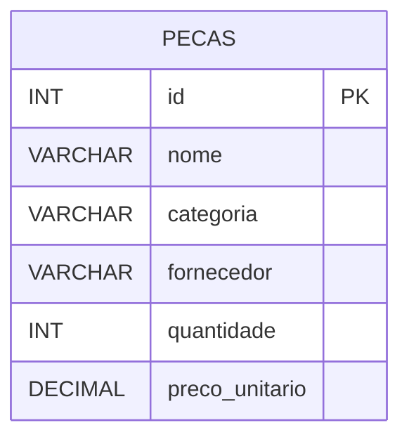

## 📋 Regras para cadastrar peças
- Todos os campos obrigatórios devem ser preenchidos.
- A categoria deve ser uma destas opções:
  - eletrica
  - mecanica
  - hidraulica

- A quantidade não pode ser menor que zero.
- O preço unitário precisa ser maior que zero.
- Todas as respostas são enviadas em JSON.

## 📦 Peças cadastradas
Foram cadastradas de 10 a 15 peças usando apenas o método POST da API.

Os registros incluem peças das categorias elétrica, mecânica e hidráulica, com fornecedores, quantidades e preços diferentes.

## Endpoints da API
### POST
Usado para cadastrar peças. Abaixo está um exemplo de dados:
```json
[
  {
    "id": 1,
    "nome": "Alternador 12V 100A (Reforçado)",
    "categoria": "eletrica",
    "fornecedor": "Bosch",
    "quantidade": 10,
    "preco_unitario": 490.00
  },
  {
    "id": 2,
    "nome": "Motor de Partida 12V High Performance",
    "categoria": "eletrica",
    "fornecedor": "Valeo",
    "quantidade": 12,
    "preco_unitario": 410.00
  },
  {
    "id": 3,
    "nome": "Relê Auxiliar 40A DNI",
    "categoria": "eletrica",
    "fornecedor": "DNI",
    "quantidade": 60,
    "preco_unitario": 17.50
  },
  {
    "id": 4,
    "nome": "Jogo de Cabos de Ignição de Silicone",
    "categoria": "eletrica",
    "fornecedor": "NGK",
    "quantidade": 20,
    "preco_unitario": 135.00
  },
  {
    "id": 5,
    "nome": "Sensor de Posição da Borboleta (TPS)",
    "categoria": "eletrica",
    "fornecedor": "Magneti Marelli",
    "quantidade": 15,
    "preco_unitario": 92.00
  },
  {
    "id": 6,
    "nome": "Par de Discos de Freio Ventilados 280mm",
    "categoria": "mecanica",
    "fornecedor": "Fremax",
    "quantidade": 18,
    "preco_unitario": 230.00
  },
  {
    "id": 7,
    "nome": "Amortecedor Dianteiro Turbo Gás",
    "categoria": "mecanica",
    "fornecedor": "Monroe",
    "quantidade": 8,
    "preco_unitario": 345.00
  },
  {
    "id": 8,
    "nome": "Kit Correia Dentada + Tensor HD",
    "categoria": "mecanica",
    "fornecedor": "Dayco",
    "quantidade": 22,
    "preco_unitario": 205.00
  },
  {
    "id": 9,
    "nome": "Bomba de Água com Junta",
    "categoria": "mecanica",
    "fornecedor": "Urba",
    "quantidade": 14,
    "preco_unitario": 155.00
  },
  {
    "id": 10,
    "nome": "Junta do Cabeçote em Aço Multi-folha",
    "categoria": "mecanica",
    "fornecedor": "Sabó",
    "quantidade": 25,
    "preco_unitario": 82.00
  },
  {
    "id": 11,
    "nome": "Bomba de Direção Hidráulica Progressiva",
    "categoria": "hidraulica",
    "fornecedor": "DHB",
    "quantidade": 5,
    "preco_unitario": 550.00
  },
  {
    "id": 12,
    "nome": "Cilindro Mestre Duplo com Reservatório",
    "categoria": "hidraulica",
    "fornecedor": "TRW",
    "quantidade": 11,
    "preco_unitario": 245.00
  },
  {
    "id": 13,
    "nome": "Mangueira de Alta Pressão Relevada",
    "categoria": "hidraulica",
    "fornecedor": "Gates",
    "quantidade": 30,
    "preco_unitario": 105.00
  },
  {
    "id": 14,
    "nome": "Válvula Direcional Hidráulica Proporcional",
    "categoria": "hidraulica",
    "fornecedor": "Rexroth",
    "quantidade": 4,
    "preco_unitario": 920.00
  },
  {
    "id": 15,
    "nome": "Cilindro Atuador de Embreagem Hidráulico",
    "categoria": "hidraulica",
    "fornecedor": "LUK",
    "quantidade": 18,
    "preco_unitario": 175.00
  }
]
```
**Resposta:**

```json
{
    "mensagem":"Produto cadastrado com sucesso."
}
```
## GET
Usado para listar as peças cadastradas.

**Resposta:**

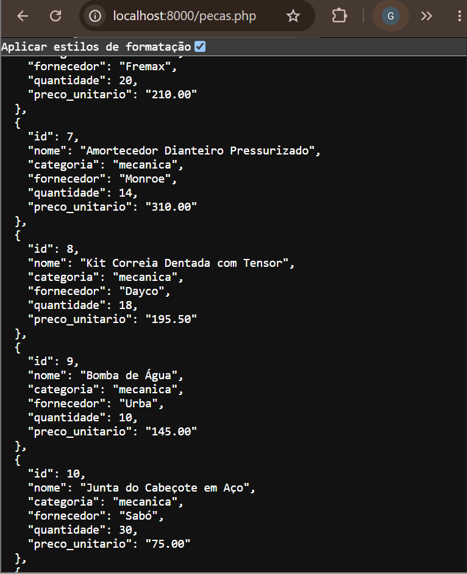

## 📊 Consultas SQL

1. **Quantidade total de unidades:** soma todas as peças guardadas no almoxarifado.
```sql
SELECT SUM(quantidade) AS total_pecas
FROM pecas;
```

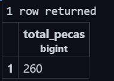


2. **Valor total do estoque:** multiplica a quantidade pelo preço unitário de cada peça e soma os resultados.
```sql
SELECT SUM(preco_unitario * quantidade) AS total_valor_pecas
FROM pecas;
```

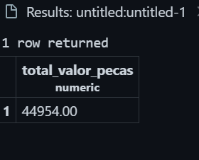


3. **Maior preço unitário:** mostra o preço mais alto cadastrado.
```sql
SELECT MAX(preco_unitario) AS peca_mais_cara
FROM pecas;
```

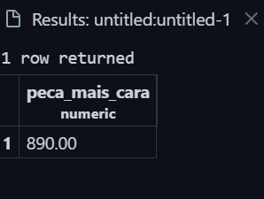


4. **Menor preço unitário:** mostra o preço mais baixo cadastrado.
```sql
SELECT MIN(preco_unitario) AS peca_mais_barata
FROM pecas;
```

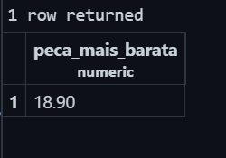

5. **Média dos preços:** calcula a média dos preços unitários com duas casas decimais.
```sql
SELECT ROUND(AVG(preco_unitario), 2) AS media_preco_pecas
FROM pecas;
```

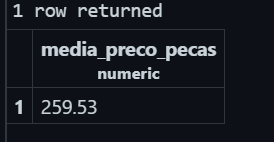


6. **Valor das peças elétricas:** soma o valor das peças da categoria elétrica.
```sql
SELECT SUM(preco_unitario * quantidade) AS valor_estoque_eletrica
FROM pecas
WHERE categoria = 'eletrica';
```

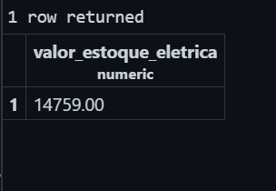
